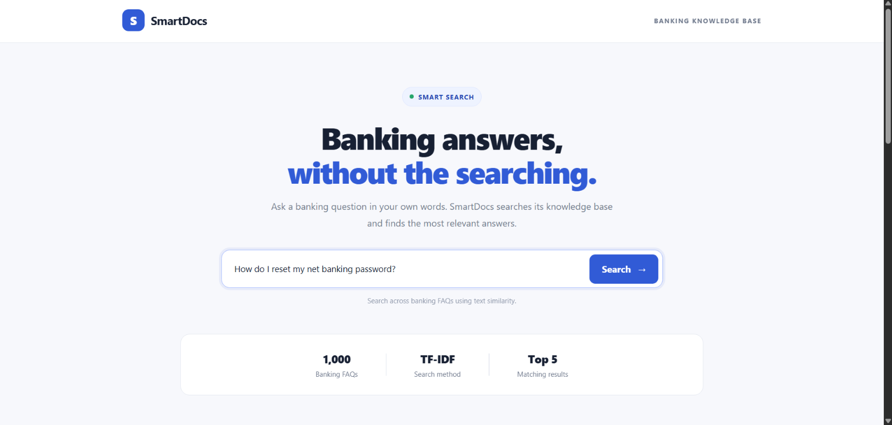
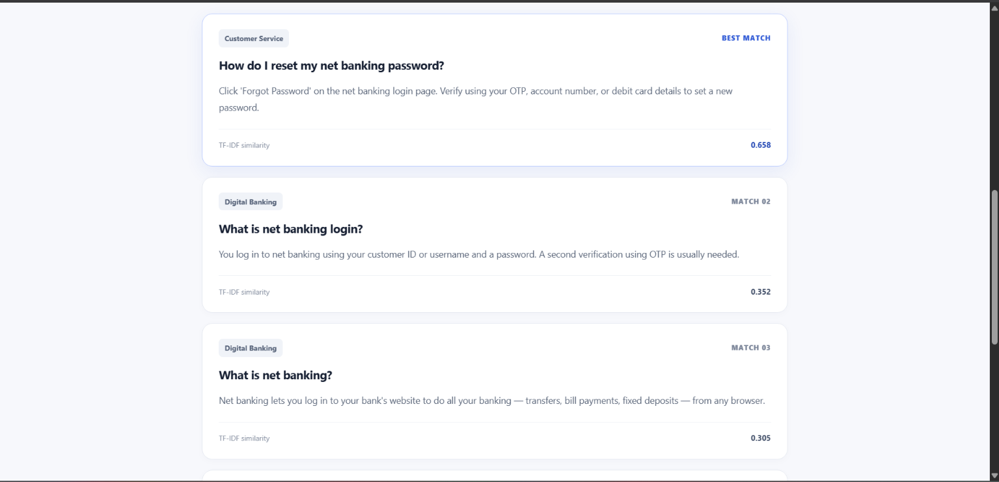

# SmartDocs — Banking FAQ Search Engine

SmartDocs is a banking FAQ search application that helps users find relevant answers to common banking questions. It uses TF-IDF and cosine similarity to retrieve matching FAQs from a dataset of 1,000 banking questions and answers.

The application provides a FastAPI backend and a simple web interface built with HTML, CSS, and JavaScript.

## Features

- Search a banking FAQ knowledge base containing 1,000 entries.
- Retrieve and rank relevant FAQs using TF-IDF and cosine similarity.
- Display the most relevant questions and answers.
- Return multiple search results.
- Provide a FastAPI endpoint for FAQ search.
- Apply query expansion for personal-loan document queries and lost or stolen debit-card queries.
- Evaluate search performance using Top-1 Accuracy, Recall@5, and Mean Reciprocal Rank (MRR).
- Compare TF-IDF with an experimental Word2Vec implementation.

## Screenshots

### SmartDocs Home — Search Interface



### Banking FAQ Search Results


## Technology Stack

- Python
- Pandas
- Scikit-learn
- FastAPI
- Uvicorn
- HTML
- CSS
- JavaScript
- Gensim for the separate Word2Vec experiment

## How It Works

### TF-IDF Search

1. Load the banking FAQ dataset from a CSV file.
2. Combine each FAQ's question and answer into searchable text.
3. Convert the searchable text into TF-IDF vectors.
4. Convert the user's query into a TF-IDF vector.
5. Calculate cosine similarity between the query and the FAQ vectors.
6. Rank the FAQs by similarity and return the requested number of results.

The main search engine uses `TfidfVectorizer` with lowercase text and English stop-word removal.

### Query Expansion

The current implementation includes two query-expansion rules:

- Personal-loan document queries are expanded with terms related to required documents, identity proof, and address proof.
- Lost or stolen debit-card queries are expanded with terms related to blocking a debit card and submitting a card-block request.

These rules are part of the existing implementation. Their individual contribution to search accuracy has not been measured separately.

### Experimental Word2Vec Search

A separate implementation, `search_engine_word2vec.py`, uses Gensim Word2Vec to train word vectors on the FAQ dataset. Each document is represented by averaging its known word vectors.

This implementation is retained as an experiment. It is not the primary search engine.

## Dataset

**File:** `banking_knowledge_base_1000.csv`

The dataset contains 1,000 banking FAQ entries with these columns:

- `Section`
- `Question`
- `Answer`

## Project Structure

```text
SmartDocs/
├── app.py
├── search_engine.py
├── search_engine_tfidf_backup.py
├── search_engine_word2vec.py
├── check_dataset.py
├── test_search.py
├── evaluate.py
├── evaluate_word2vec.py
├── evaluation_queries.csv
├── banking_knowledge_base_1000.csv
├── requirements.txt
├── README.md
├── .gitignore
├── screenshots/
│   └── smartdocs-search.png
└── static/
    ├── index.html
    ├── style.css
    └── script.js
```

## Setup and Installation

These instructions use Windows PowerShell.

### 1. Open the project folder

```powershell
cd "$HOME\Documents\SmartDocs"
```

### 2. Create a virtual environment

```powershell
python -m venv .venv
```

### 3. Activate the virtual environment

```powershell
.\.venv\Scripts\Activate.ps1
```

### 4. Install the main application dependencies

```powershell
python -m pip install -r requirements.txt
```

## Run the Application

Start the FastAPI development server:

```powershell
python -m uvicorn app:app --reload
```

Open the local application in your browser:

`http://127.0.0.1:8000`

The FastAPI interactive API documentation is available at:

`http://127.0.0.1:8000/docs`

### Search API

The application exposes a GET endpoint:

`/search`

Example:

`http://127.0.0.1:8000/search?question=How%20do%20I%20reset%20my%20net%20banking%20password`

The endpoint accepts:

- `question`: Required search query.
- `limit`: Maximum number of results, from 1 to 20; defaults to 5.

The response contains the submitted question, result count, and matching FAQs with similarity scores.

## Testing

Run the existing search tests:

```powershell
python test_search.py
```

The three existing tests passed:

- Personal-loan document search.
- Net banking password reset search.
- Debit-card blocking FAQ retrieval within the top three results.

These tests cover specific cases and should not be interpreted as a complete measure of search quality.

## Evaluation Methodology

The project was evaluated using 20 test queries with expected FAQ questions.

The evaluation script, `evaluate.py`, reports:

- **Top-1 Accuracy:** The proportion of queries for which the expected FAQ is ranked first.
- **Recall@5:** The proportion of queries for which the expected FAQ appears within the top five results.
- **Mean Reciprocal Rank (MRR):** The average reciprocal rank of the expected FAQ, using zero when it does not appear in the retrieved results.

The same evaluation queries were used for the TF-IDF and Word2Vec implementations.

## Evaluation Results

The following results were measured by running the evaluation scripts on the current implementation.

| Metric | TF-IDF | Word2Vec |
|---|---:|---:|
| Evaluation queries | 20 | 20 |
| Top-1 correct | 7/20 | 1/20 |
| Top-1 Accuracy | 35.00% | 5.00% |
| Expected FAQ found in top five | 14/20 | 2/20 |
| Recall@5 | 70.00% | 10.00% |
| MRR | 0.4958 | 0.0600 |
| Top-1 failures | 13 | 19 |

### Interpretation

TF-IDF performed better than the current Word2Vec implementation on this 20-query evaluation set.

TF-IDF retrieved the expected FAQ within the top five results for 14 queries, but ranked it first for only seven. This indicates that ranking and query matching remain areas for improvement.

Word2Vec retrieved the expected FAQ within the top five for only two queries. It is therefore retained as an experiment rather than the primary search implementation.

These results apply to the current dataset, implementations, and evaluation queries. They do not establish that one method is universally better than the other.

## Limitations

- TF-IDF relies on word-frequency patterns and may struggle when a user's wording differs significantly from the FAQ wording.
- Related banking questions can receive similar scores even when they have different intended answers.
- General questions may rank above more specific questions.
- Query expansion currently covers only two categories of queries.
- The evaluation contains 20 queries and may not represent all possible banking questions.
- The Word2Vec implementation performed poorly on the current evaluation set.
- The evaluation uses one expected FAQ per query and does not assess answer correctness or completeness independently.

## Future Improvements

Potential future work includes:

- Improving query matching and ranking.
- Expanding evaluation coverage with additional independently selected test queries.
- Investigating query expansion and measuring its impact through controlled experiments.
- Exploring sentence embeddings and other retrieval approaches.
- Comparing alternative approaches using the same evaluation dataset.

These are future improvements and have not been implemented or evaluated as part of the current results.

## Current Status

SmartDocs currently includes a TF-IDF-based banking FAQ search engine, a FastAPI endpoint, a web frontend, basic search tests, and evaluation scripts for TF-IDF and Word2Vec.

The measured evaluation results are documented above, including the current retrieval limitations.